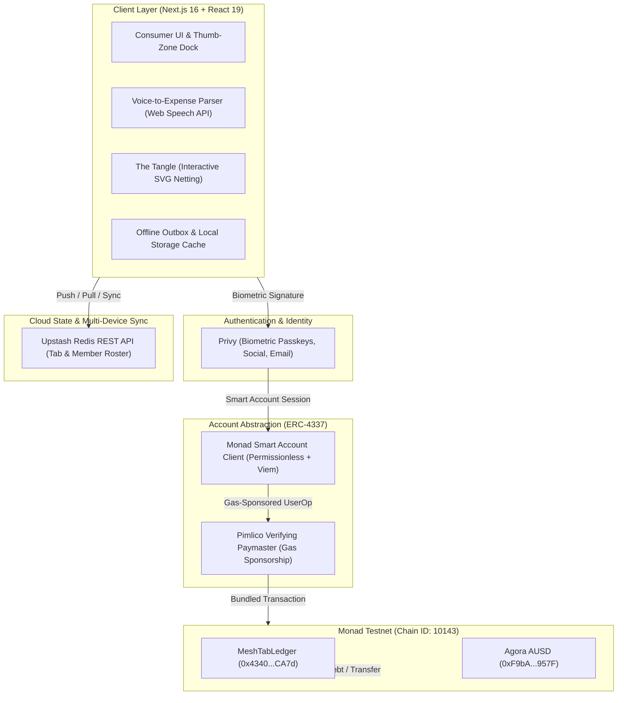

# MeshTab ⚡

> **Zero-Friction Collaborative Expense Sharing & Multilateral Debt Netting on Monad**  
> *Built for the Monad Metropolis 2026 Hackathon — Consumer Products & Payments Track*

[](https://mesh-tab.vercel.app/)
[](https://nextjs.org/)
[-836EF9?style=for-the-badge&logo=ethereum)](https://testnet.monadexplorer.com/)
[](https://privy.io/)
[](https://agora.finance/)
[](https://upstash.com/)

---

## 💡 The Problem & The Solution

**The Problem:** Traditional group expense apps (like Splitwise) create tangled, crisscrossing I.O.U. webs. When a trip ends, friends are forced to execute dozens of redundant cross-transfers, calculate complex currency fees, or chase each other across banking apps.

**The Solution:** MeshTab combines high-throughput blockchain infrastructure with consumer fintech simplicity:
- **Multilateral Netting Engine ("The Tangle"):** An off-chain greedy bipartite matching algorithm that detects and collapses circular debt loops ($A \to B \to C \to A$), reducing total payment volume and cross-transfers by up to **75%**.
- **Biometric Passkeys & Embedded Smart Accounts:** Instant FaceID/TouchID enrollment powered by **Privy**, generating ERC-4337 smart accounts with zero seed phrases, browser extensions, or popups.
- **Gasless Agora AUSD Settlement:** 1-click debt settlement in **Agora AUSD** (6-decimal digital dollars) executed through **Pimlico Paymasters** for 100% sponsored gas on Monad.
- **Voice-to-Expense Dictation & Smart Staging:** Speak expenses naturally using browser-native **Web Speech API** or test interactive receipt presets. The parser extracts amounts and vendors into an editable staging card for human verification before saving.
- **Offline-First Resilience & Dual Modes:** A device-isolated **Demo Mode** (`sample` and `blank`) allows instant presentation without testnet faucets or internet connectivity, while **Testnet Mode** integrates real Monad contracts and **Upstash Redis** real-time persistence.

---

## 📜 Deployed Monad Testnet Contracts

Both smart contracts are deployed and verified on **Monad Testnet (Chain ID: 10143)**:

| Contract | Address | Monad Explorer |
|---|---|---|
| **MeshTabLedger** | `0x43405B9D8E30ff76910009E79131200c862fCA7d` | [View on MonadExplorer](https://testnet.monadexplorer.com/address/0x43405B9D8E30ff76910009E79131200c862fCA7d) |
| **MockAUSD (Agora Digital Dollar)** | `0xF9bA02Cd0aFc210e0867852eEb0E994B07d9957F` | [View on MonadExplorer](https://testnet.monadexplorer.com/address/0xF9bA02Cd0aFc210e0867852eEb0E994B07d9957F) |

*The `MeshTabLedger` contract exposes `payNettedDebt(string tabId, address creditor, uint256 amount)` to trustlessly settle group liabilities on-chain.*

---

## 🚀 Core Features

| Feature | Implementation | Benefit |
|---|---|---|
| 🔄 **The Tangle (Netting Engine)** | Off-chain bipartite matching rendered on an animated SVG canvas | Collapses $N$-way group debt into the theoretical minimum direct settlements. |
| 🎙️ **Voice-to-Expense Dictation** | Browser Web Speech API with currency regex parsing | Dictate `"Paid 45 dollars for groceries"` to pre-fill expenses hands-free. |
| 🛡️ **Active Balance Protection** | Real-time state validation in `ManageMembers` | Prevents group admins or members with active balances from being deleted until settled. |
| ⛽ **Gasless Sponsorship (ERC-4337)** | Pimlico Verifying Paymasters + Privy Smart Wallets | Users never hold or spend MON for gas fees; transactions execute seamlessly. |
| 📴 **Offline Outbox Engine** | FIFO operations queue with auto-sync on reconnect | Log tabs and expenses on flights or in subways with optimistic local state. |
| 🌓 **Adaptive System Aesthetics** | Vanilla Tailwind CSS with instant Dark/Light switching | High-contrast ergonomics designed for real-world mobile use. |

---

## 📐 System Architecture



---

## 🎭 Web3 $\to$ Web2 Abstraction Standard

MeshTab adheres to strict consumer fintech design principles — zero blockchain jargon leaks into the standard user experience:

| Blockchain Mechanic | User-Facing Interface | Architectural Reality |
|---|---|---|
| `Gas Fees / Gwei` | **Free / Sponsored** | Pimlico Paymasters absorb all Monad transaction fees. |
| `Private Keys / Seed Phrases` | **Passkey (FaceID / TouchID)** | Hardware WebAuthn enclave managed via Privy SDK. |
| `Contract Approval & Call` | **1-Tap Settle Up** | Batch `approve` + `payNettedDebt` UserOps in background. |
| `ERC-20 Token Transfers` | **Digital US Dollars ($)** | Agora AUSD represents 1:1 digital dollar values. |
| `Transaction Latency` | **Instant UI Update** | Optimistic local updates backed by Monad's 10,000 TPS. |

---

## 🏃 Quick Start

### 1. Clone & Install
```bash
git clone https://github.com/miracles2motion/Mesh-Tab.git
cd "Mesh-Tab"
npm install
```

### 2. Configure Environment
Copy `.env.example` to `.env.local`:
```bash
cp .env.example .env.local
```

Fill in the required service credentials (see table below):

```env
# 1. Upstash Redis (Tab sync & membership)
UPSTASH_REDIS_REST_URL="https://your-database.upstash.io"
UPSTASH_REDIS_REST_TOKEN="your_upstash_token"

# 2. Monad Testnet Web3 Config
NEXT_PUBLIC_MONAD_RPC_URL="https://testnet-rpc.monad.xyz"
NEXT_PUBLIC_MOCK_AUSD_ADDRESS="0xF9bA02Cd0aFc210e0867852eEb0E994B07d9957F"
NEXT_PUBLIC_MESH_TAB_LEDGER_ADDRESS="0x43405B9D8E30ff76910009E79131200c862fCA7d"

# 3. Privy Authentication & Smart Wallets
NEXT_PUBLIC_PRIVY_APP_ID="your_privy_app_id"
```

> **Note:** MeshTab includes comprehensive mock fallbacks and local demo modes. You can explore the entire app, test debt netting, and run simulated settlements out-of-the-box without requiring live keys.

### 3. Run Development Server
```bash
npm run dev
```
Open [http://localhost:3000](http://localhost:3000) in your browser.

### 4. Production Build
```bash
npm run build
```
*Builds cleanly with Next.js 16 and React 19 with 0 TypeScript and lint errors.*

---

## 🎬 3-Minute Demo Walkthrough

1. **Explore Landing (`/`):**
   * Interact with the **Live Netting Visualizer** to see how crisscrossing debts collapse into streamlined settlements.
   * Click **Launch App** or **Explore Demo Mode**.
2. **Explore The Lisbon Benchmark (`/tab/lisbon-24`):**
   * Notice the 4 group members ($1,200 total expenses).
   * Tap **Run Netting** to open the interactive SVG graph engine. Watch 12 gross peer-to-peer debts collapse into just 3 direct payments (saving 75% in transfer friction).
3. **Multimodal Expense Logging (`/tab/lisbon-24/expense/new`):**
   * Tap the **Mic** button and say: `"I paid 80 dollars for rental car gas"`.
   * Watch the parser extract the amount and description into an **Editable Staging Card**.
   * Adjust splits or tap **Save Expense**.
4. **1-Click Settlement (`/tab/lisbon-24`):**
   * Tap **Settle Up** to open the settlement drawer.
   * In Demo Mode, watch your balance recalculate and your debt clear to $0.00 instantly with confetti feedback.
   * In Testnet Mode, approve and execute `payNettedDebt` on Monad Testnet gaslessly via Privy Smart Wallets.
5. **Simulated Bank Cash-Out (`/settings` or Home Header):**
   * Tap your cash balance to open the Cash-Out drawer and simulate instant payout to a bank account.

## 🛣️ Mainnet Production Architecture

For our comprehensive A-to-Z execution plan on scaling MeshTab from hackathon testnet to commercial production (including native Agora AUSD, Privy fiat banking on/off-ramps, OpenZeppelin contract audits, and mobile store packaging), see the full specification in Mainnet Roadmap

---

## 📄 License

MIT License. Built for the Monad Metropolis 2026 Hackathon.

