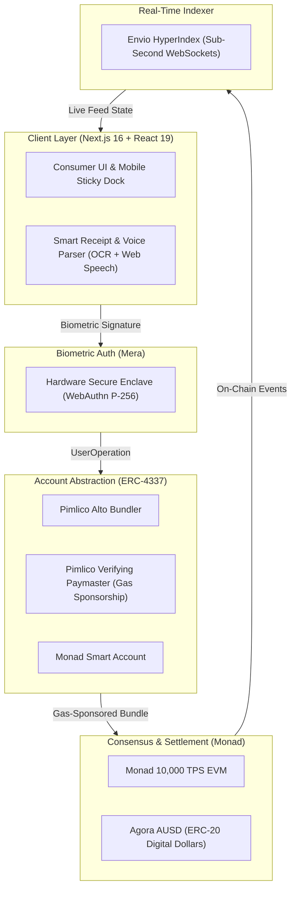

# MeshTab ⚡

> **Zero-Friction Collaborative Expense Sharing & Multilateral Debt Netting on Monad**  
> *Built for the Monad Metropolis 2026 Hackathon — Consumer Products & Payments Track*

[](https://mesh-tab.vercel.app/)
[](https://nextjs.org/)
[](https://monad.xyz/)
[](https://www.typescriptlang.org/)
[](https://agora.finance/)

---

## 💡 The Problem & The Solution

**The Problem:** Traditional group expense apps (like Splitwise) create messy, crisscrossing I.O.U. loops. Settle-ups require endless manual chasing, international bank wires, and predatory subscriptions.

**The Solution:** MeshTab replaces manual notebooks with an automated, zero-friction settlement protocol:
- **Multilateral Netting Engine ("The Tangle"):** An off-chain graph algorithm cancels out circular debt loops ($A \to B \to C \to A$), reducing total payment volume and cross-transfers by up to **75%**.
- **Smart Receipt OCR & Voice Recognition:** Snap receipt photos via mobile camera OCR or dictate expenses with live voice recognition. The parser extracts line items into an editable staging card for human verification before signing.
- **Biometric Passkeys (Mera):** One-tap FaceID/TouchID onboarding using hardware-secured WebAuthn (P-256). Zero seed phrases, extensions, or wallet popups.
- **Sub-Second Digital Dollar Settlement:** Direct, gasless debt settlement in **Agora AUSD** powered by **Monad's 10,000 TPS** and **Pimlico Account Abstraction**.
- **Radical Web3→Web2 Abstraction:** Complex blockchain mechanics (gas, nonces, RPCs, hex signatures) are completely abstracted into a clean, modern consumer fintech UI.

---

## 🚀 Core Features

| Feature | Description |
|---|---|
| 🔄 **Multilateral Netting** | Resolves complex group debts into the absolute minimum direct settlement transactions. |
| 📸 **Receipt OCR & Voice Recognition** | Camera photo parsing and voice note transcription with human-in-the-loop overrides. |
| 🛡️ **Active Balance Protection** | Prevents group members with active debts from being removed until settled ($0.00). |
| ⛽ **Sponsored Gas (ERC-4337)** | All user operations (expenses, joins, netting) are permanently sponsored by Paymasters. |
| 🌓 **Light & Dark Parity** | High-contrast Day mode and sleek Dark mode with instant toggle and zero layout shift. |
| 📱 **Mobile-First Sticky Dock** | Ergonomic thumb-zone navigation capsule for rapid tab creation and expense logging. |

---

## 📐 System Architecture



---

## 🎭 Web3→Web2 Abstraction Standard

Users interact with MeshTab as a normal consumer payments app:

| Web3 Concept | User-Facing Experience | Architecture |
|---|---|---|
| `Gas Fee / Gwei` | **Free / Sponsored** | Pimlico Verifying Paymasters absorb all network fees. |
| `Private Key / Seed Phrase` | **Passkey (FaceID / TouchID)** | Hardware WebAuthn Secure Enclave (P-256). |
| `Smart Contract Call` | **Save / Confirm** | UserOperations executed gaslessly in background. |
| `ERC-20 Token` | **US Dollars (AUSD)** | Agora AUSD represents 1:1 digital USD value. |
| `Block Confirmation` | **Instant Sync (0.3s)** | Monad 1-second finality paired with Envio WebSockets. |

---

## 🏃 Quick Start

### 1. Clone & Install
```bash
git clone https://github.com/miracles2motion/Mesh-Tab.git
cd "Mesh-Tab"
npm install
```

### 2. Run Local Development Server
```bash
npm run dev
```
Open [http://localhost:3000](http://localhost:3000) in your browser.

### 3. Production Build
```bash
npm run build
```
*Builds cleanly with Next.js 16 Turbopack with 0 TypeScript errors.*

---

## 🛠️ Environment Configuration

Copy `.env.example` to `.env.local` to connect live production services:

```env
# Dynamic Authentication & On-Ramp
NEXT_PUBLIC_DYNAMIC_ENVIRONMENT_ID=your_dynamic_environment_id

# Pimlico Account Abstraction (Gas Sponsorship)
NEXT_PUBLIC_PIMLICO_API_KEY=your_pimlico_api_key

# Monad Network RPC
NEXT_PUBLIC_MONAD_RPC_URL=https://rpc-mainnet.monad.xyz

# Envio HyperIndex Indexer
NEXT_PUBLIC_ENVIO_GRAPHQL_URL=https://indexer.envio.dev/v1/graphql

# Smart Contract Addresses (Monad)
NEXT_PUBLIC_MESHTAB_CONTRACT_ADDRESS=your_deployed_meshtab_address
NEXT_PUBLIC_AUSD_CONTRACT_ADDRESS=your_deployed_ausd_address
```

> **Note:** MeshTab includes comprehensive mock fallbacks for local and offline demonstration without requiring external API keys.

---

## 🎬 3-Minute Demo Walkthrough

1. **Explore Landing (`/`):** Test the interactive **Netting Visualizer** and toggle light/dark theme. Click **Launch App**.
2. **One-Tap Passkey Sign-In (`/login`):** Click **Continue with Passkey** (simulating hardware biometric authentication).
3. **The Financial Hub (`/home`):** View your aggregate net balance (*You Owe* vs. *You're Owed*). Filter tabs or tap **Lisbon Weekend**.
4. **Multimodal Expense Logging (`/tab/lisbon-24/expense/new`):** 
   - Click **Add New Expense** $\to$ tap **Receipt OCR** or **Voice Input**.
   - Notice the **Staging Proposal Card** with `Editable • Auto-Extracted` badges. Adjust any numbers or splits directly.
5. **Netting & Settlement (`/tab/lisbon-24`):**
   - Click **Run Tangle Netting** to visualize cycle simplification.
   - Tap **Settle Up** on the balance card to execute a sponsored AUSD payoff on Monad. Your balance immediately reflects **$0.00 (Settled)** with an instant feed receipt.

---

## 📄 License

MIT License. Built with ❤️ for the Monad Metropolis 2026 Hackathon.
