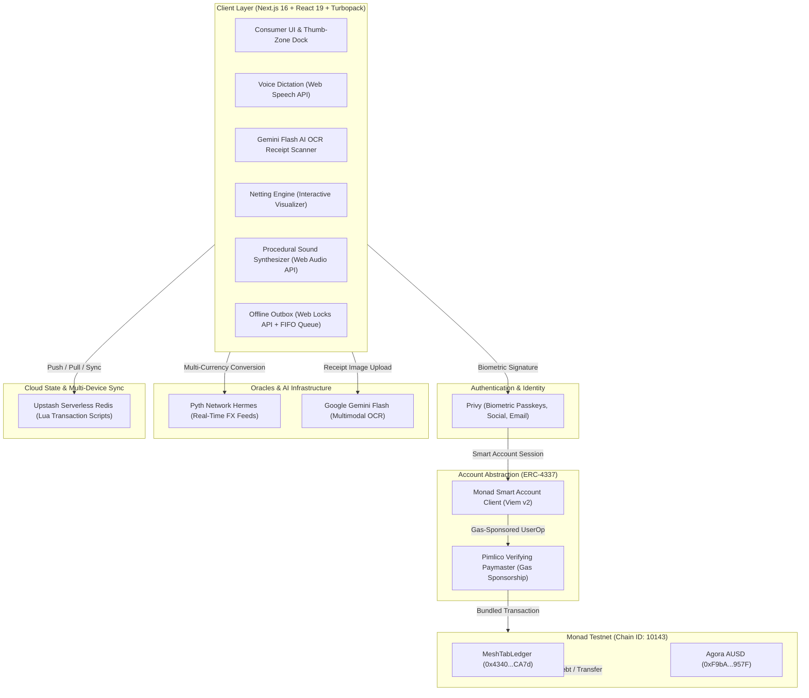

# MeshTab ⚡

> **Close the tab. Keep the friends.**  
> *Cross-currency group expense netting with one-tap on-chain settlement on Monad Testnet.*  
> *Built for the Monad Metropolis 2026 Hackathon — Consumer Products & Payments Track*

[](https://mesh-tab.vercel.app/)
[](https://nextjs.org/)
[-836EF9?style=for-the-badge&logo=ethereum)](https://testnet.monadexplorer.com/)
[](https://agora.finance/)
[](https://pimlico.io/)
[](https://privy.io/)
[](https://pyth.network/)
[](https://ai.google.dev/)
[](https://upstash.com/)

---

## 💡 The Problem & The Solution

**The Problem:** Traditional group expense apps (like Splitwise) create tangled, crisscrossing I.O.U. webs. When a trip ends, friends are forced to execute dozens of redundant cross-transfers, calculate complex currency fees, or chase each other across banking apps. Worse, existing crypto expense tools burden non-crypto users with gas tokens, seed phrases, network popups, and raw hex addresses.

**The Solution:** MeshTab combines high-throughput blockchain infrastructure with consumer fintech simplicity:
- **Multilateral Netting Engine:** An off-chain greedy net-position matching algorithm that computes debtor and creditor positions, collapsing multi-currency debts into minimal direct payments ($\le N-1$ transfers) before on-chain settlement.
- **Biometric Passkeys & Embedded Smart Accounts:** Instant FaceID/TouchID enrollment powered by **Privy**, generating ERC-4337 smart accounts with zero seed phrases, browser extensions, or popups.
- **Gasless Agora AUSD Settlement:** 1-click debt settlement in **Agora AUSD** (6-decimal digital dollars) executed through **Pimlico Paymasters** for 100% sponsored gas on Monad.
- **Google Gemini Flash Vision AI OCR:** Snap a photo of any restaurant receipt, grocery slip, or hotel invoice to instantly extract the total amount and merchant name in ~1 second via `@google/genai`.
- **Pyth Network Hermes Multi-Currency FX Engine:** Real-time foreign exchange feeds convert EUR, GBP, JPY, CAD, AUD, NGN, and BRL at mid-market rates with 60-second caching and resilient fallback guarantees.
- **Voice-to-Expense Dictation & Smart Staging:** Speak expenses naturally using browser-native **Web Speech API**. The parser extracts amounts and vendors into an editable staging card for human verification before saving.
- **Offline-First Resilience & The 3-Mode Architecture:** A persistent local outbox (`meshTab_testnet_outbox`) with operation folding and multi-tab Web Locks synchronizes sequentially (push-first-then-pull) upon reconnection. Operates across 3 isolated modes: `sample` (Lisbon '24 demo trip), `blank` (clean sandbox), and `testnet` (Monad Metropolis live on-chain mode).
- **Zero-Dependency Procedural Audio:** 10 rich micro-interaction sound effects synthesized in real time via the native **Web Audio API** (`AudioContext`), eliminating external audio assets and 404 latency.

---

## 📊 Feature Maturity Matrix (Live vs. Prototype)

To maintain complete transparency with judges, engineering leadership, and users, MeshTab clearly delineates fully implemented on-chain production features from interactive UX prototypes:

| Feature | Category | Current Status & Architecture |
|---|---|---|
| **MeshTabAgoraLedger Settlement** | 🟢 Live On-Chain | Deployed on Monad Testnet (`payNettedDebt`). Executes atomic debt settlement in official Agora AUSD. |
| **Agora AUSD Official Faucet** | 🟢 Live On-Chain | Official Agora faucet (`requestFunds`) providing 10,000 Agora AUSD for testnet group tabs. |
| **Pimlico Gas Sponsorship** | 🟢 Live Production | 100% gasless transactions via ERC-4337 Paymaster integration with Privy Smart Wallets. |
| **Pyth Hermes FX Engine** | 🟢 Live Production | Low-latency foreign exchange oracle proxy (`/api/pyth`) with 60s caching and graceful fallbacks. |
| **Gemini Flash Vision OCR** | 🟢 Live Production | Multimodal receipt scanning endpoint (`/api/receipt-scan`) using Google GenAI SDK. |
| **Upstash Redis + Lua Engine** | 🟢 Live Production | Atomic serverless transactions (`LUA_ADD_EXPENSE`, `LUA_DELETE_EXPENSE`, `LUA_SETTLE_DEBT`). |
| **Offline Outbox & 2-Way Sync**| 🟢 Live Production | Local FIFO outbox with operation folding, Web Locks concurrency, and push-first-then-pull reconciliation. |
| **Web Audio Synthesizer** | 🟢 Live Production | 10 custom synthesized sound effects generated procedurally via browser `AudioContext`. |
| **Virtual Visa Card** | 🟡 Interactive Prototype | Generates card numbers, CVV, expiry, freeze toggles, and spend limits; BaaS card issuance (Stripe Issuing/Lithic) on roadmap. |
| **Agora APY Yield Vault** | 🟡 Simulated Engine | Real-time mathematical compounding ticker (`Math.pow` @ 4.80% APY); mainnet ERC-4626 smart contract on roadmap. |
| **Fiat Off-Ramp Drawer** | 🟡 Interactive Prototype | Consumer off-ramp UI featuring Chog security guardrail to prevent confusion between testnet tokens and real fiat bank accounts. |
| **Bluetooth Mesh Transport** | 🟡 Roadmap Spec | UI specification modal illustrating future handset-to-handset BLE transport without cellular coverage. |

---

## 📜 Deployed Monad Testnet Contracts

Smart contracts deployed and verified on **Monad Testnet (Chain ID: 10143)**:

| Contract | Address | Explorer | Role & Verification |
|---|---|---|---|
| **MeshTabAgoraLedger** | `0x54f02333ea8D80C175A1C8Bdb71ef709cF424C83` | [View on Monadscan](https://testnet.monadscan.com/address/0x54f02333ea8D80C175A1C8Bdb71ef709cF424C83) | Atomic group debt settlement engine (`payNettedDebt`) for official Agora AUSD |
| **Agora AUSD (Official Token)** | `0xa9012a055bd4e0eDfF8Ce09f960291C09D5322dC` | [View on Monadscan](https://testnet.monadscan.com/address/0xa9012a055bd4e0eDfF8Ce09f960291C09D5322dC) | Official Agora digital dollar ERC-20 on Monad Testnet (6 decimals) |
| **Agora Official Faucet** | `0xd236c18D274E54FAccC3dd9DDA4b27965a73ee6C` | [View on Monadscan](https://testnet.monadscan.com/address/0xd236c18D274E54FAccC3dd9DDA4b27965a73ee6C) | Official Agora liquidity faucet dripping 10,000 AUSD per claim (`requestFunds`) |

> **Official Agora AUSD Integration.** MeshTab connects 100% directly to official Agora infrastructure on Monad Testnet. Evaluators can fund their smart account with **$10,000.00 Agora AUSD** in one tap directly from the official Agora Faucet, and settle netted group balances on-chain through `MeshTabAgoraLedger` ([Monadscan Settlement TX](https://testnet.monadscan.com/tx/0xafd413d0ebd3e9da42b92fe61a3f737a3a437108cf367c159d6861712bc829f0), Block 69400512).

---

## 🚀 Core Feature Breakdown

| Feature | Implementation | Consumer Benefit |
|---|---|---|
| 🔄 **Netting Engine** | Off-chain greedy net-position matching rendered on an interactive SVG canvas | Collapses multi-currency group debts into minimal (≤ N-1) direct settlements. |
| 📸 **Gemini Vision AI OCR** | Google Gemini Flash multimodal vision pipeline via `@google/genai` | Snap a photo of a paper receipt to extract the amount and merchant name in ~1 second. |
| 💱 **Pyth Network FX Oracle** | Pyth Hermes REST API with 60-second edge revalidation | Split travel expenses in EUR, GBP, JPY, or AUD converted at mid-market rates. |
| 🎙️ **Voice-to-Expense Dictation** | Browser Web Speech API with currency regex parsing | Dictate `"Paid 45 dollars for groceries"` to pre-fill expenses hands-free. |
| ⛽ **Gasless Sponsorship (ERC-4337)** | Pimlico Verifying Paymasters + Privy Smart Wallets | Users never hold or spend MON for gas fees; transactions execute seamlessly. |
| 📴 **Offline Outbox Engine** | FIFO operations queue with multi-tab Web Locks and 2-way server sync | Log tabs and expenses on flights or in subways with optimistic local state. |
| 🤖 **MeshBuddy AI Co-Pilot** | Floating AI assistant with custom knowledge base and neural TTS | Query tab analytics ("Who owes the most?") with human-like voice responses. |
| 🎵 **Procedural Sound Engine** | Browser Web Audio API procedural synthesis (10 distinct SFX) | Rich acoustic feedback (clicks, sweeps, success chimes) with zero external asset loading. |
| 💳 **Virtual Visa Card (Prototype)** | Local state persistence with spending limits and freeze controls | Demonstrates instant POS spendability for settled funds via digital wallet provisioning. |
| 📈 **Agora APY Vault (Simulated)** | Continuous compounding formula (`4.80% APY`) with live ticking counter | Demonstrates how idle group travel funds earn yield during 7–14 day vacations. |

---

## 📐 System Architecture



---

## 🎭 Web3 $\to$ Web2 Abstraction Standard

MeshTab adheres to strict consumer fintech design principles — zero blockchain jargon leaks into the standard user experience:

| Blockchain Mechanic | User-Facing Interface | Architectural Reality |
|---|---|---|
| `Gas Fees / Gwei` | **Free / Sponsored** | Pimlico Paymasters absorb 100% of Monad transaction fees. |
| `Private Keys / Seed Phrases` | **Passkey (FaceID / TouchID)** | Hardware WebAuthn enclave managed via Privy SDK. |
| `Contract Approval & Call` | **1-Tap Settle Up** | Batch `approve` + `payNettedDebt` UserOps in background. |
| `ERC-20 Token Transfers` | **Digital US Dollars ($)** | Agora AUSD represents 1:1 digital dollar values. |
| `Transaction Latency` | **Instant Sub-Second Finality** | Optimistic local updates backed by Monad's 10,000 TPS. |
| `Hex Wallet Addresses` | **Member Profile & Avatar** | 0x addresses resolved dynamically from verified tab roster. |

---

## 🏃 Quick Start

### 1. Clone & Install
```bash
git clone https://github.com/miracles2motion/Mesh-Tab.git
cd "Mesh-Tab"
npm install
```

### 2. Configure Environment
Copy `.env.example` to `.env.local`:
```bash
cp .env.example .env.local
```

Configure your credentials:
```env
# 1. Upstash Redis (Tab sync & membership)
UPSTASH_REDIS_REST_URL="https://your-database.upstash.io"
UPSTASH_REDIS_REST_TOKEN="your_upstash_token"

# 2. Monad Testnet Web3 Config
NEXT_PUBLIC_MONAD_RPC_URL="https://testnet-rpc.monad.xyz"
NEXT_PUBLIC_AGORA_AUSD_ADDRESS="0xa9012a055bd4e0eDfF8Ce09f960291C09D5322dC"
NEXT_PUBLIC_AGORA_FAUCET_ADDRESS="0xd236c18D274E54FAccC3dd9DDA4b27965a73ee6C"
NEXT_PUBLIC_MESH_TAB_LEDGER_ADDRESS="0x54f02333ea8D80C175A1C8Bdb71ef709cF424C83"

# 3. Privy Authentication & Smart Wallets
NEXT_PUBLIC_PRIVY_APP_ID="your_privy_app_id"

# 4. Google Gemini Vision OCR (Receipt Scanning)
GEMINI_API_KEY="your_gemini_api_key"
```

> **Note:** MeshTab includes complete local demo modes (`sample` and `blank`). You can explore the entire app, test debt netting, scan receipts, and run simulated settlements out-of-the-box without requiring live keys.

### 3. Run Development Server
```bash
npm run dev
```
Open [http://localhost:3000](http://localhost:3000) in your browser.

### 4. Production Build
```bash
npm run build
```
*Builds cleanly with Next.js 16 and React 19 with 0 TypeScript and compilation errors.*

---

## 🎬 3-Minute Demo Walkthrough

1. **Explore Landing (`/`):**
   - Interact with the **Live Netting Visualizer** to see how crisscrossing debts collapse into streamlined settlements.
   - Click **Try Demo Mode** or **Launch App**.
2. **Explore The Lisbon Benchmark (`/tab/lisbon-24`):**
   - Review the 4 group members ($1,499.10 total expenses across Aisha, Kemi, Ben, and You in EUR, GBP, and USD).
   - Tap **Run Netting** to open the interactive SVG graph engine. Watch 9 multi-currency transfers collapse into just 3 direct AUSD payments ($391.54 net liquidity).
3. **Multimodal Expense Logging (`/tab/lisbon-24/expense/new`):**
   - **Receipt OCR:** Tap the camera icon, upload a receipt, and watch Gemini Flash extract the amount and merchant in ~1 second.
   - **Voice Dictation:** Tap the mic button and say: `"I paid 80 dollars for rental car gas"`.
   - **Pyth FX:** Select EUR or JPY to see real-time Pyth Hermes conversions into USD.
4. **1-Click Settlement (`/tab/lisbon-24`):**
   - Tap **Settle Up** on your negative balance card.
   - In Demo Mode, watch your balance recalculate and your debt clear to $0.00 instantly with confetti feedback.
   - In Testnet Mode, approve and execute `payNettedDebt` on Monad Testnet gaslessly via Pimlico Paymaster.
5. **Official Agora Faucet (`/home`):**
   - Connect your wallet on Testnet Mode and tap **Add Funds** $\to$ **Confirm $10,000.00 Agora AUSD Allocation** to fund your testnet account with instant testing liquidity directly from the official Agora Faucet on Monad.
6. **Virtual Card & Yield Preview:**
   - Tap the **Virtual Card** banner on the Home dashboard to view instant card spendability controls.
   - Watch the **Agora APY Vault** ticker on the tab page compound group savings at 4.80% APY.

---

## 🛣️ Production & Mainnet Roadmap

- **Phase 1: Metropolis Hackathon (Current) 🟢**
  - Instant FaceID passkeys & ERC-4337 smart accounts via **Privy**.
  - Sub-second debt settlement on **Monad Testnet** (`MeshTabAgoraLedger.sol`).
  - 100% sponsored gas fees powered by **Pimlico Verifying Paymasters**.
  - Digital dollar liquidity via **Agora AUSD**.
  - Mid-market foreign exchange rates via **Pyth Network Hermes Oracles**.
  - Multimodal receipt OCR powered by **Google Gemini Flash Vision**.
  - Resilient offline outbox queue with 2-way server synchronization.

- **Phase 2: Monad Mainnet & Live Yield (Q3 2026) 🟡**
  - Comprehensive security review and smart contract deployment on Monad Mainnet.
  - Native **Agora AUSD** ERC-4626 Tokenized Yield Vault integration.
  - Automated background netting settlement via **Privy Server Wallets**.

- **Phase 3: Consumer Scale & Banking Rails (Q4 2026) ⚪**
  - Seamless fiat on-ramps and bank cash-outs leveraging **Privy Funding Rails**.
  - Virtual Visa Debit Card point-of-sale spendability via licensed BaaS partner (**Stripe Issuing** / **Lithic**).
  - Native iOS & Android app store release with background peer sync.

---

## 📄 License

MIT License. Built for the Monad Metropolis 2026 Hackathon.
